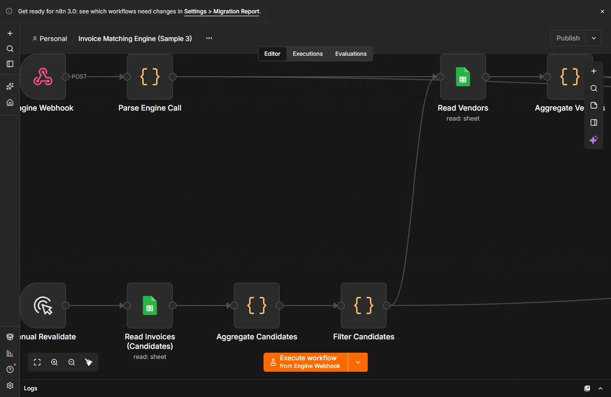
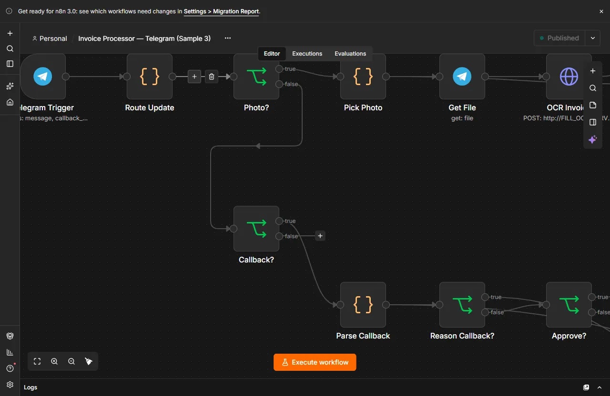

# Invoice Processor — Sample 3 (AI Automation Portfolio)

**Status: built and tested locally — NOT declared ready.** The live run (real Telegram bot, real Google Sheets, real OCR service, real n8n hosting) is still pending and needs the user's accounts. See `readiness-review.md`.

## What it is

A three-way invoice-matching sample: a supplier sends an invoice photo on Telegram; the system extracts it with OCR and matches it **line by line** against the purchase order **and** the goods receipts — price, quantity and tax, all in integer piastres — and routes every discrepancy to a human reviewer on Telegram. Every state change is written to an Audit Log with old state, new state, reason, decider and time.

**The one idea that makes it more than an OCR template:** the match is cumulative. Each PO line has a *received balance* (`accepted_received − already_invoiced`), and every matched invoice draws it down in an append-only Allocations ledger. A second invoice against the same PO line sees the reduced balance; a third invoice after full consumption is blocked. The demo proves it with 100 notebooks: 60 + 40 match, the next 50 is refused.

## The matching engine (7 deterministic stages, no LLM)

| Stage | Rule |
|---|---|
| 0 | Document hash already seen → `duplicate_image`, no new row, audit only |
| A | Document validation: required fields + internal arithmetic (`line_total == qty × unit_price`, `subtotal == Σ lines`, `subtotal + tax == total`). Fails → Needs Review / correction |
| B | Identity: vendor by code / tax ID (never name similarity); duplicate `(vendor_id, invoice_number)`; PO exists, belongs to the vendor, is open |
| C | Line matching: each invoice line matches a PO line by stable `po_line_id`; unknown SKU → Blocked |
| D | Price: per-line variance `qty × |invoice_unit − po_unit|`; cap **EGP 50** enforced **both** per line **and** on the sum of absolute line variances. Over either cap → Blocked (non-approvable). Within both caps and > 0 → Needs Review — the **only** approvable reason. The review outcome is returned only after Stages E and F have passed, so a combined price-variance + tax-mismatch invoice is Blocked, never reviewable |
| E | Quantity: `available_received = accepted_received − already_invoiced` per PO line; no receipt at all → `pending_receipt` (parks, not a violation); `new > available` → Blocked; zero quantity tolerance |
| F | Financial: recompute line totals, tax (VAT 14% taxable / 0% exempt, half-up to the piastre) and grand total in integers; any mismatch → **Blocked** (`tax_mismatch` — a correction, not an exception) |
| G | Decision: full pass → `auto_matched` (`exact_match` or `partial_match`); otherwise the stage's disposition, no allocation written |

**Zero automatic tolerance:** auto-match = exact equality in integer piastres after deterministic rounding applied identically to both sides. A float engine would false-mismatch the trap case (7 × 19.99 = 139.92999999999998 in doubles); integer arithmetic is exact.

**Approval is a narrow, gated exception.** Only `price_variance_review` can be approved, only by the authorized reviewer, only when the decider is not the submitter, only for the current `(invoice_id, version, review_id)`. The check order is stale → submitter → auth → repeat → approvable. The review branch never decides or writes an allocation: an approval calls the Engine in `apply_exception` mode, which re-runs the critical invariants at commit time, records the allocation and finalizes `exception_approved`. `auto_matched` and `exception_approved` stay distinguishable, and neither means the invoice was paid.

**Correction is versioned.** Request correction → the Engine snapshots the invoice's current values into the `correction_requested` audit event *at request time* (before the operator edits anything) → the operator fixes values in Sheets → revalidate creates version+1 and re-runs all 7 stages. An approval for the old version is blocked as stale.

## What was proven (local n8n 2.48.7, real execution)

- **16-scenario suite: 53/53 checks passed, twice in a row** (`invoice-test-results-run1.json`, `invoice-test-results-run2.json`, `run_invoice_tests.py`): clean match with mixed tax rates, valid partial (60 of 100), cumulative completion (40 more → 100/100), sequential competition (third invoice blocked), small price variance approved as an exception, large variance blocked with the approval attempt blocked and audited, the sum cap (3000 + 2100 = 5100 → blocked), duplicate invoice number, duplicate image, unknown PO, missing receipt → revalidate after the receipt arrives, tax mismatch blocked, OCR corruption → correction → revalidate to auto-match, unauthorized + submitter self-approval both blocked, versioned correction + replayed v1 approval blocked as stale, the float trap (7 × 19.99) matched exactly, and the round-4 combined case (price variance within cap + wrong tax → blocked, never reviewable).
- **Write-failure visibility (T-WRITEFAIL):** with Sheets writes forced to fail, the Engine webhook answers with an error, writes no invoice row and sends no Telegram message; the same payload succeeds once writes are restored. A failed write can never be reported as a completed operation.
- **Final invariants (asserted at the end of each run):** 7 `auto_matched`, 2 `exception_approved`, PEN-BLUE consumed 35/50, every invoice audited, no over-consumption anywhere.
- **Engine probe: 45/45** (`probe_engine.py`, `engine-probe-results.json`): the pure engine logic exercised directly in Node with in-memory tables, including the branches the live suite cannot reach.
- **Real Tesseract 5.3.4 accuracy on the synthetic invoices: 202/202 fields** (`ocr-accuracy-results.json`): header + every line field on all 16 fixtures, confidence 93–95. The misread in S12 (line total 6000 instead of 5000) is *simulated* in the mock OCR to prove the correction loop — the real engine read that image correctly. See `test-matrix.md`.
- **Real workflows round-trip through n8n:** imported and exported back with 0 parameter differences, connections equal (`exported-from-n8n/`, `export_check_invoice.py`).
- **Real OCR intake end-to-end (T-OCR):** the mock-Telegram workflow variant whose OCR node calls the real local Tesseract service submits a fixture and it auto-matches — the real OCR path, not only the mock.

## Honest limits (read before showing this to anyone)

- **All data is synthetic and labelled as such.** POs, receipts and invoices are fixtures; the watermark on every image says so. No commercial result is claimed.
- **Sheets is a demo store, not a transactional database.** No duplicate allocation is proven only for the supported **sequential** demo. Under truly concurrent submissions the Sheets store cannot guarantee it — the limitation is documented in `schema.md` and `review-report.md`, and the claim is worded that way everywhere.
- **OCR is Tesseract 5.3.4 via a small local HTTP service** (`invoice-ocr-service.py`, port 7998). It is free, offline and deterministic on these fixtures. It returns `image_hash` (SHA-256 of the received bytes) as part of its contract, and any replacement OCR adapter must do the same. No Vision model, no LLM for any decision.
- **One Telegram bot, one webhook.** The unified Telegram workflow has a single Trigger (`message` + `callback_query`) with a Router; the Matching Engine is a separate workflow called over its own webhook. Total: **2 workflows**, not 3.
- **The Engine owns every Sheets write.** The Telegram workflow never writes Sheets — it only talks to Telegram and to the Engine. The Engine answers its webhook with an explicit Respond to Webhook node, and only after every write has landed (a Collect node gathers all write branches first — and inspects their results, so a failed write fails the execution visibly). The real Sheets write nodes carry no `continueOnFail`. See `review-report.md` for why `lastNode` mode was not reliable here.
- **EGP only, one VAT rule (14% / 0%), images only (2 synthetic layouts), no PDF, no discounts, no multi-currency.** A discount field breaks Stage A arithmetic and routes to correction.
- **The Telegram bot, Google Sheets, and the OCR service are not connected here.** The live run is Blocked by Credentials (see `readiness-review.md`).
- `DEMO_TODAY` is fixed to 2026-11-22 in the builder so the test set is reproducible. Update it for a live demo day.

## Files

| File | What it is |
|---|---|
| `plan.md` | Approved plan + todo (Arabic) |
| `schema.md` | Data schema, 7 tables, 7 stages, review rules, reason codes, seed data, the 16 scenarios |
| `test-matrix.md` | The 16 scenarios, fixtures, and seed data (Arabic) |
| `setup-instructions.md` | Sheets columns, bot setup, OCR service, import steps, live-test steps |
| `review-report.md` | Design review, defects found and fixed, evidence |
| `readiness-review.md` | What is proven vs what is still Blocked |
| `case-study.md` | Short portfolio case study |
| `demo-script.md` | 90-second demo script |
| `invoice-matching-engine-workflow.json` (+ `-MOCK`) | The 7-stage engine: Webhook (match / apply_exception / revalidate) + Manual Trigger (batch revalidate) → reads 6 tables → one Code node → writes → Respond to Webhook. 38 nodes. Only this workflow writes Sheets. |
| `invoice-telegram-workflow.json` (+ `-MOCK`, + `-MOCK-REALOCR`) | ONE Telegram entry → Router → Intake branch (photo → OCR → call Engine → notify / review request to the reviewer only) + Review branch (callback → authorization + freshness → call Engine in apply mode → confirmation). `-MOCK-REALOCR` is the mock variant whose OCR node calls the real local Tesseract service (test-only). |
| `build_workflows_invoice.py` + `invoice_extra.py` | Builders (single source of truth — fix defects here, never hand-edit JSON) |
| `mock-server.js` | In-memory Sheets (7 tabs) + Telegram + mock OCR (test only, port 7999) |
| `invoice-ocr-service.py` + `invoice_extract.py` | Real Tesseract HTTP service + shared field extraction (port 7998) |
| `gen_fixtures.py` + `fixtures/` + `fixtures.json` | 15 synthetic invoice images (2 layouts) + ground truth |
| `ocr-accuracy-test.py` + `ocr-accuracy-results.json` | Real Tesseract accuracy measurement (202/202) |
| `probe_engine.py` + `engine-probe-results.json` | Pure-engine checks (45/45) |
| `run_invoice_tests.py` + `invoice-test-results-run1.json` + `invoice-test-results-run2.json` | 16-scenario runner + results (53/53 twice) |
| `export_check_invoice.py` + `exported-from-n8n/` | Real-workflow round-trip export check (0 diffs) |

## Run the tests yourself

1. n8n 2.48.7 running on `http://127.0.0.1:5678` (see `~/workspace/n8n-test/start-n8n.sh`).
2. Start the services from this directory: `node mock-server.js` (port 7999) and `python3 invoice-ocr-service.py` (port 7998). Tesseract must be installed (`apt-get install -y tesseract-ocr`).
3. `python3 run_invoice_tests.py run1` — expect `53/53 n8n checks passed`.
4. `python3 ocr-accuracy-test.py` — expect `202/202` fields.
5. `python3 probe_engine.py` — expect `45/45 engine checks passed`.
6. `python3 export_check_invoice.py` — expect `ALL OK`.

**Note on test scripts:** `run_invoice_tests.py` and `export_check_invoice.py` log in to the *local* n8n test rig with the throwaway account `test@example.local` (password in the scripts). That account exists only in this VM's local n8n; it has no access to any real service. Replace it if you run the tests on your own n8n.

## Screenshots

## Demo Video

- [Demo Video (MP4)](demo/invoice-processor-vo-fixed-60s-slow.mp4)
- [90-second Demo Script](demo/demo-script.md)
